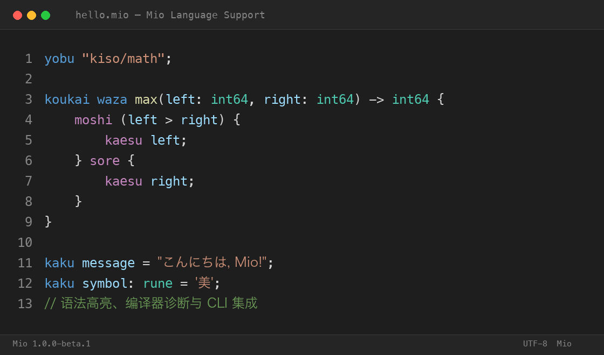
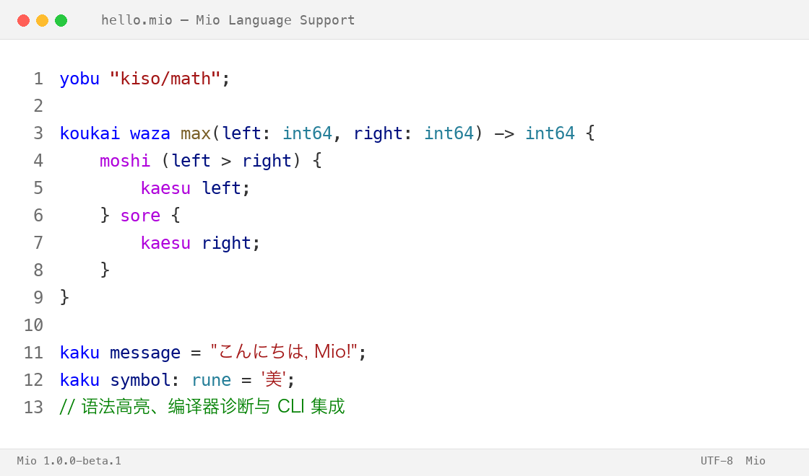

# Mio — Programming Language Tools

<p align="center">
  
</p>

<p align="center"><strong>Visual Studio Code support for the Mio programming language</strong></p>

<p align="center">
  English · <a href="README.zh-CN.md">简体中文</a>
</p>

<p align="center">
  <a href="https://github.com/mio-kobo/mio">Mio Project</a> ·
  <a href="https://github.com/mio-kobo/mio/blob/Mio-2/docs/LANGUAGE.md">Language Reference</a> ·
  <a href="https://github.com/mio-kobo/mio/blob/Mio-2/docs/BUNKO.md">Bunko Stdlib</a> ·
  <a href="https://github.com/mio-kobo/mio/releases">Releases</a>
</p>

Mio is a statically typed programming language featuring Japanese romaji keywords, a Mochi bytecode toolchain, and the modular **Bunko** standard library. This extension brings `.mio` and `.miog` (Mio Graph) support into VS Code with syntax highlighting, smart editing, snippets, MioCore LSP diagnostics and navigation, formatting, Test Explorer, and Mio CLI integration.

Basic editing features—syntax highlighting, snippets, smart editing, and import path completion—work out of the box without the Mio CLI. Compiler-backed features activate automatically when `mio` (or `mio.exe`) is on `PATH`, or when `mio.executablePath` is configured.

---

## Syntax Preview

**Dark Theme**



**Light Theme**



> Preview images are generated from the extension's TextMate scope palette. See [docs/images/README.md](docs/images/README.md) for instructions on replacing them with editor screenshots.

---

## Features

- **TextMate Syntax Highlighting (V0.5)**:
  - Keywords: `kaku`, `waza`, `moshi`, `sore`, `aida`, `kaesu`, `nukeru`, `tsuzuku`, `yobu`, `kata`, `sentaku`, `awase`, `baai`, `koukai`, `teisu`
  - Literals: `hai`, `iie`, `mu`
  - Built-in types & constraints: fixed-width integers, `float32`, `float64`, `rune`, `bool`, `string`, `unit`, `resource`, `Map`, `Number`, `Integer`, `Signed`, `Float`
  - Accurate scoping for functions, closures, structs, enums, `awase` match arms, generics, imports, arrays, comments, and operators (keywords inside strings/comments are never highlighted).
- **Language Conventions & Snippets**:
  - Auto-closing pairs, bracket matching, `//` and `/* ... */` comments, indentation rules, folding, and Mio-aware word patterns.
  - Rich snippets for variables, constants, functions, closures, generics, control flow, structs, enums, exhaustive `awase` matches, arrays, `Map`, and nullable values.
- **Smart Editing (Mio v2.1.2 Compatible)**:
  - Context-aware Tab-navigated blocks for `moshi` and `aida`, plus automatic parentheses for `chant();`, `len()`, and numeric conversions (`int8`–`int64`, `uint8`–`uint32`, `float32`, `float64`, `rune`) in clear expression positions.
  - Import path completion inside `yobu "…"` using a verified Mio Full v2.1.2 catalog, workspace modules, and configured Bunko roots.
  - Optional conservative semicolon insertion on `Enter` (`mio.editing.autoInsertSemicolon`).
- **MioCore Language Server (`mio lsp`)**:
  - Live diagnostics for open and unsaved buffers with incremental edits, version validation, request cancellation, and UTF-8 to UTF-16 position mapping.
  - **Mio: Restart Language Server** restarts the server after installing Mio or when it stops responding. If the CLI is missing at startup, the extension shows one notification per session.
  - **Semantic Navigation**: Hover (signatures, inferred types, docs), Go to Definition (across files and Bunko imports), Find References (symbol-identity keyed), Outline view, Completion, and Signature Help.
  - **Auto-import & Organize Imports**: Accepting unambiguous package-member completions inserts `yobu`; run **Mio: Organize Imports** (`Shift+Alt+O` / `Shift+Option+O`) to sort and clean imports.
- **Formatting (`mio fmt`)**:
  - Format the active buffer (including unsaved edits) via **Format Document** (`Shift+Alt+F` / `Shift+Option+F`) or check formatting with **Mio: Check Formatting**.
- **Test Explorer**:
  - Discovers `test_*` functions in `*_test.mio` files via LSP document symbols and runs them with `mio test --format=json` (supports individual `--run` or package-level runs, pass/fail/skip states, and compile-error reporting).
- **CLI Fallback & Safe Execution**:
  - Automatically falls back to `mio check --format=json` when the LSP is disabled, unavailable, or stopped (only one diagnostic source is active at a time).
  - All CLI invocations use argument arrays with `shell: false`, safely handling paths with spaces, Chinese, or Japanese characters.
- **Mio Graph (`.miog`)**:
  - Compiles `.miog` visual blueprints into validated `<name>.mio` source files.

---

## Installation

### From VSIX

```bash
code --install-extension mio-language-support-0.3.1.vsix
```

Reload VS Code and open any `.mio` file.

### From Source

```bash
git clone https://github.com/mio-kobo/mio-vscode.git
cd mio-vscode
npm ci
npm run compile
npx vsce package
code --install-extension mio-language-support-0.3.1.vsix
```

The Marketplace identity is `exmikupro.mio-language-support`. See [PUBLISHING.md](PUBLISHING.md) for the independent release workflow.

### Supported Platforms

- **macOS**: Apple Silicon & Intel
- **Windows**: x64 & ARM64
- **Linux**: x64 & ARM64

The extension is platform-neutral; the Mio CLI binary must match your OS and architecture.

---

## Configuration

### Mio CLI & Bunko Setup

Build the CLI from the [Mio repository](https://github.com/mio-kobo/mio):

```bash
go build -o mio ./cmd/mio
./mio version
```

Document formatting requires a CLI with `mio fmt` support. Auto-import and Organize Imports require a native Mio CLI with [semantic import editing support](https://github.com/mio-kobo/mio/pull/117).

Add `mio` (or `mio.exe` on Windows) to your `PATH`, or set `mio.executablePath`. The extension does not scan the workspace for binaries.

For projects importing `kiso/...`, the extension follows the CLI's Bunko lookup order:
1. The `MIO_BUNKO` environment variable (if it points to a directory).
2. The nearest `bunko/` directory above the source file.

### Extension Settings

| Setting | Default | Description |
| --- | --- | --- |
| `mio.executablePath` | `""` | Absolute path to the Mio CLI (`~` expanded). Empty searches `PATH` for `mio` / `mio.exe`. |
| `mio.languageServer.enabled` | `true` | Launch the MioCore language server (`mio lsp`). Falls back to `mio check` when disabled or unavailable. |
| `mio.diagnostics.enabled` | `true` | Enable diagnostics (via LSP when running, or `mio check --format=json` fallback). |
| `mio.diagnostics.onSave` | `true` | Fallback only: run `mio check` after saving a `.mio` file (350 ms debounce). |
| `mio.outputDirectory` | `""` | Output directory for `mio build` (supports `${workspaceFolder}`). Empty writes `.mochi` next to the source. |
| `mio.editing.smartSnippets` | `true` | Offer context-aware Mio snippets with native `Tab` navigation. |
| `mio.editing.autoInsertParentheses` | `true` | Insert parentheses and control-flow blocks when accepting smart suggestions. |
| `mio.editing.autoInsertSemicolon` | `false` | Conservatively insert `;` on `Enter` for complete statements (requires `editor.formatOnType`). |
| `mio.completion.importPaths` | `true` | Complete `yobu` import paths from the Mio v2.1.2 catalog and local modules. |
| `mio.completion.bunkoRoots` | `[]` | Additional Bunko library roots (absolute or workspace-relative) for import completion. |
| `mio.format.enable` | `true` | Enable Mio document formatting. |
| `mio.format.organizeImports` | `true` | Organize `yobu` imports when formatting with Mio. |
| `mio.format.executable` | `""` | Custom formatter executable. Empty uses `mio.executablePath` or `PATH`. |
| `mio.format.timeout` | `10000` | Maximum time in milliseconds to wait for Mio formatting. |

> `mio.languageVersion` is intentionally not exposed because the current Mio CLI has no language-version flag; the grammar and snippets target V0.5.

### Recommended Workspace Snippets

#### Format & Organize Imports on Save

```json
{
  "[mio]": {
    "editor.defaultFormatter": "exmikupro.mio-language-support",
    "editor.formatOnSave": true,
    "editor.codeActionsOnSave": {
      "source.organizeImports": "explicit"
    }
  }
}
```

Set `mio.format.organizeImports` to `false` if you want **Format Document** to adjust whitespace only.

#### Auto-Insert Semicolons on Enter

Semicolon insertion on `Enter` requires VS Code's native on-type formatting:

```json
{
  "mio.editing.autoInsertSemicolon": true,
  "[mio]": {
    "editor.formatOnType": true
  }
}
```

#### Spell Checking (cSpell)

When Code Spell Checker (`cSpell`) is installed, this extension defaults `cSpell.enabledFileTypes.mio` to `false` so Mio keywords like `waza` and `kaku` do not trigger false `Unknown word` warnings. To re-enable it, set `"mio": true` inside `cSpell.enabledFileTypes` in your `settings.json`.

---

## Commands

| Command ID | Palette Title | Shortcut | Requires CLI |
| --- | --- | --- | --- |
| `mio.checkCurrentFile` | Mio: Check Current File | — | Fallback only |
| `mio.runCurrentFile` | Mio: Run Current File | — | Yes |
| `mio.buildCurrentFile` | Mio: Build Current File | — | Yes |
| `mio.formatDocument` | Mio: Format Document | `Shift+Alt+F` / `Shift+Option+F` | Yes (`mio fmt`) |
| `mio.organizeImports` | Mio: Organize Imports | `Shift+Alt+O` / `Shift+Option+O` | Yes (LSP) |
| `mio.checkFormatting` | Mio: Check Formatting | — | Yes (`mio fmt`) |
| `mio.showCompilerVersion` | Mio: Show Compiler Version | — | Yes |
| `mio.restartLanguageServer` | Mio: Restart Language Server | — | Yes (LSP) |
| `mio.openOutput` | Mio: Open Output | — | No |
| `mioGraph.generateSource` | Mio Graph: Generate Mio Source | — | No (validation needs CLI) |

- **Run** and **Build** save dirty `.mio` buffers before executing.
- **Check Current File** checks unsaved buffer text in a temporary package copy without forcing a save (when LSP is running, it reports that live diagnostics are already active).
- If the CLI is missing, the extension displays a prompt with **Open Settings** and **Installation Guide** actions.

---

## Mio Graph (`.miog`)

`.miog` files are Mio Graph blueprints. Running **Mio Graph: Generate Mio Source** compiles the active graph into `<name>.mio` beside it, opens the generated file, and validates it with the Mio CLI.

- **Headless Core**: `src/graph` (model, validation, semantic analysis, IR, and code generator) has no VS Code dependency.
- **Deterministic Execution**: Execution order follows `exec` connections rather than node coordinates or JSON order. Side-effecting calls are evaluated once via `__mio_graph_N` temporaries.
- **Safe Overwrite**: Existing `.mio` files are only overwritten without confirmation if they begin with `// Generated by Mio Graph`.

See [docs/MIO_GRAPH.md](docs/MIO_GRAPH.md) for the specification and [examples/mio-graph](examples/mio-graph) for sample graphs.

---

## Smart Editing Details (v0.3.1)

- **Control Flow & Calls**: Accepting `moshi` or `aida` inserts a condition and indented block with native `Tab` / `Shift+Tab` navigation. Accepting `chant` or `len` inserts `chant();` / `len()` with the cursor inside parentheses. Existing parentheses/blocks are preserved, and snippet aliases (`if`, `while`, `print`, `array-len`, `rune-literal`) remain available.
- **Numeric Conversions**: `int8`–`int64`, `uint8`–`uint32`, `float32`, `float64`, and `rune` gain `()` in expression positions (e.g., `kaku x = uint8`), while type annotations, arrays, and generic type arguments stay plain. `uint64` conversion is omitted because the pinned Mio v2.1.2 compiler reports `E0201` for `uint64(1)`.
- **Diagnostics Freshness**: Stale versioned LSP responses and results for closed documents are discarded. When using CLI fallback, new edits cancel pending checks. Incomplete statements (like a partial `yobu`) still legitimately report compiler errors such as `E0101` until completed.

See [docs/RELEASE-0.3.1.md](docs/RELEASE-0.3.1.md) for validation tests, performance measurements, and implementation limits.

---

## Language Versions

Keyword gates come from `internal/token/token.go`; the current Mio CLI uses `token.V05` (`internal/bunko/program.go`):

| Version | Added Keywords / Syntax |
| --- | --- |
| V0.1 | `kaku`, `waza`, `moshi`, `sore`, `kaesu`, `hai`, `iie`, `mu` |
| V0.2 | `aida`, `nukeru`, `tsuzuku` |
| V0.3 | `yobu` |
| V0.4 | `kata`, `sentaku`, `awase`, `baai` |
| V0.5 | `koukai`, `teisu` |

---

## Known limitations

- **Single Diagnostic per Analysis**: Both `mio lsp` and `mio check` stop at the first compiler error, so the Problems panel displays at most one Mio diagnostic per analysis.
- **Partial Buffers & Cross-Module Indexing**: Semantic navigation requires parsable statements; broken fragments are not guessed. Cross-module references cover the active program graph and open workspace documents.
- **Completion Scope**: Completion does not yet offer `baai` match-arm variants or type-parameter names inside type annotations.
- **Unsupported LSP Capabilities**: Workspace symbols, rename, and semantic tokens are not yet implemented (see [docs/LSP_PLAN.md](docs/LSP_PLAN.md)).
- **No Debugger**: Debugging (including debugging from Test Explorer) is not available.
- **Windows Launchers**: `.cmd` / `.bat` wrappers are not executed; configure a native `mio.exe` to keep process execution shell-free.
- **Output Directory**: `mio.outputDirectory` applies only to `mio build`; `mio run` always executes the source file.

---

## Development & Testing

```bash
npm ci
npm run compile
npm run lint
npm test
npx vsce package
npm run check:vsix
```

- `npm test` runs Node unit tests (manifest, grammar scopes, diagnostics mapping, CLI resolution, process runner, LSP options) followed by VS Code Extension Host integration tests via `@vscode/test-electron`.
- `pretest` clones and builds `cmd/mio` from the pinned core SHA in `core-source.json` into `.test-tmp/` (**Git and Go are required** to run tests; missing tools or build failures fail the suite). The packaged extension itself has no Go dependency.
- See [MIGRATION.md](MIGRATION.md) for standalone repository development and publishing notes.

---

## License & Artwork

Extension code is licensed under the [MIT License](LICENSE). The extension icon is a 128×128 RGBA conversion of `assets/pluginIcon-source.svg`. Character illustrations under `assets/mascot/` are **not** bundled due to separate licensing terms; see [NOTICE.md](NOTICE.md).

## Links

- [Mio Repository](https://github.com/mio-kobo/mio)
- [Mio Language Reference](https://github.com/mio-kobo/mio/blob/Mio-2/docs/LANGUAGE.md)
- [Bunko Standard Library](https://github.com/mio-kobo/mio/blob/Mio-2/docs/BUNKO.md)
- [JetBrains Mio — Programming Language Tools](https://github.com/mio-kobo/mio-jetbrains)
- [Issue Tracker](https://github.com/mio-kobo/mio/issues)
