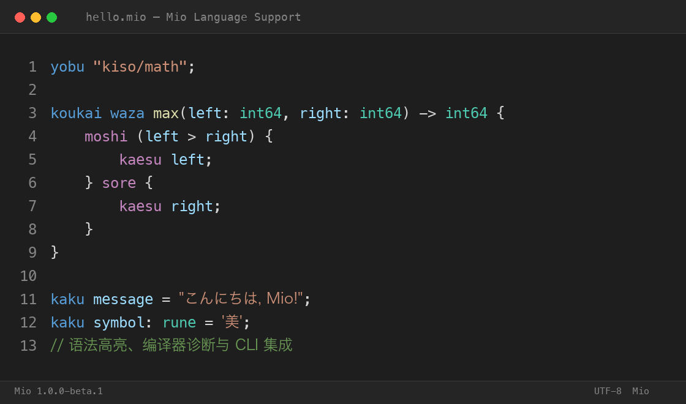
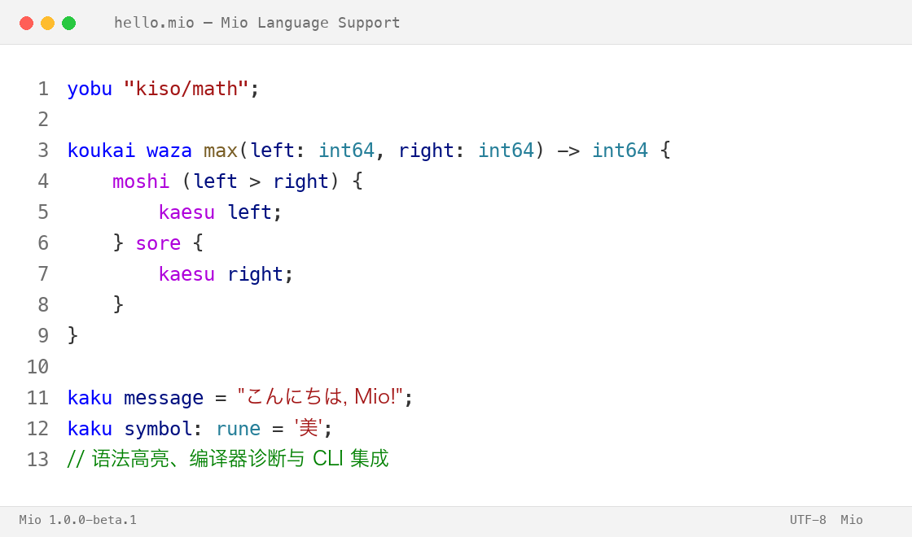

# Mio — Programming Language Tools

<p align="center">
  
</p>

<p align="center"><strong>Mio 编程语言的 Visual Studio Code 支持</strong></p>

<p align="center">
  <a href="README.md">English</a> · 简体中文
</p>

<p align="center">
  <a href="https://github.com/mio-kobo/mio">Mio 项目</a> ·
  <a href="https://github.com/mio-kobo/mio/blob/Mio-2/docs/LANGUAGE.md">语言文档</a> ·
  <a href="https://github.com/mio-kobo/mio/blob/Mio-2/docs/BUNKO.md">Bunko 标准库</a> ·
  <a href="https://github.com/mio-kobo/mio/releases">Releases</a>
</p>

Mio 是一门静态强类型编程语言，使用日语罗马音关键字，以 Mochi 字节码为执行目标，并通过模块化的 **Bunko** 标准库按需导入能力。本插件为 VS Code 提供 `.mio` 与 `.miog`（Mio Graph）文件的语法高亮、智能编辑、代码片段、MioCore 语言服务器诊断与导航、代码格式化、测试浏览器（Test Explorer）以及 Mio CLI 集成。

即使未安装 Mio CLI，插件也可提供语法高亮、代码片段、智能编辑与导入路径补全等基础编辑体验。当 `PATH` 中存在 `mio`（或 `mio.exe`），或配置了 `mio.executablePath` 时，编译器相关功能会自动启用。

---

## 语法高亮预览

**深色主题**



**浅色主题**



> 预览图由插件 TextMate 作用域配色生成，替换为真实编辑器截图的方法见 [docs/images/README.md](docs/images/README.md)。

---

## 功能特性

- **TextMate 语法高亮（V0.5）**：
  - 关键字：`kaku`、`waza`、`moshi`、`sore`、`aida`、`kaesu`、`nukeru`、`tsuzuku`、`yobu`、`kata`、`sentaku`、`awase`、`baai`、`koukai`、`teisu`
  - 字面量：`hai`、`iie`、`mu`
  - 内置类型与约束：固定宽度整数、`float32`、`float64`、`rune`、`bool`、`string`、`unit`、`resource`、`Map`，以及 `Number`、`Integer`、`Signed`、`Float`
  - 精准高亮函数定义与调用、闭包、结构体、枚举、`awase` 分支、泛型、模块导入、数组、注释与运算符（普通字符串与注释内的关键字不会被误高亮）。
- **编辑器约定与代码片段**：
  - 括号与引号自动闭合与包围、括号匹配、`//` 与 `/* ... */` 注释、缩进规则、语法折叠及 Mio 标识符识别。
  - 涵盖变量、常量、函数、闭包、泛型、条件分支、`aida` 循环、结构体、枚举、穷举 `awase` 匹配、数组、`Map` 与可空值的代码片段。
- **智能编辑（兼容 Mio v2.1.2）**：
  - `moshi` 与 `aida` 补全自动生成支持原生 `Tab` 导航的条件与缩进代码块；`chant`、`len` 及数值转换（`int8`–`int64`、`uint8`–`uint32`、`float32`、`float64`、`rune`）在明确表达式位置自动补全括号。
  - 在 `yobu "…"` 内提供基于 Mio Full v2.1.2 目录、工作区模块及 Bunko 根目录的导入路径补全。
  - 可选的 `Enter` 保守自动分号插入（`mio.editing.autoInsertSemicolon`）。
- **MioCore 语言服务器（`mio lsp`）**：
  - 支持未保存缓冲区的实时编译诊断，具备增量编辑同步、文档版本校验、请求取消及 UTF-8 字节偏移到 VS Code UTF-16 位置的精确映射。
  - **语义导航**：悬停提示（签名、推断类型与文档）、跨文件与 Bunko 导入跳转定义、基于符号身份的查找引用、大纲视图（Outline）、自动补全及函数签名提示。
  - **自动导入与整理导入**：接受无歧义的包成员补全可自动插入 `yobu`；执行 **Mio: 整理导入**（`Shift+Alt+O` / `Shift+Option+O`）即可排序并清理导入。
- **代码格式化（`mio fmt`）**：
  - 支持对当前缓冲区（含未保存修改）执行 **格式化文档**（`Shift+Alt+F` / `Shift+Option+F`），以及 **Mio: 检查格式**。
- **测试浏览器（Test Explorer）**：
  - 通过 LSP 文档符号发现 `*_test.mio` 中的 `test_*` 测试函数，并调用 `mio test --format=json` 运行（支持单测 `--run` 或整包运行，展示通过、失败、跳过状态及编译错误）。
- **CLI 回退诊断与安全执行**：
  - 语言服务器禁用、不可用或停止时自动回退至 `mio check --format=json`（任一时刻仅一套诊断生效）。
  - 所有外部进程均采用参数数组与 `shell: false` 调用，原样传递含空格、中文或日文的路径。
- **Mio Graph（`.miog`）**：
  - 将 `.miog` 可视化蓝图编译为经过校验的 `<name>.mio` 源码文件。

---

## 安装

### 从 VSIX 安装

```bash
code --install-extension mio-language-support-0.3.1.vsix
```

重新加载 VS Code 后打开任意 `.mio` 文件即可。

### 从源码构建

```bash
git clone https://github.com/mio-kobo/mio-vscode.git
cd mio-vscode
npm ci
npm run compile
npx vsce package
code --install-extension mio-language-support-0.3.1.vsix
```

Marketplace 插件标识为 `exmikupro.mio-language-support`。独立发布流程见 [PUBLISHING.md](PUBLISHING.md)。

### 支持平台

- **macOS**：Apple Silicon 与 Intel
- **Windows**：x64 与 ARM64
- **Linux**：x64 与 ARM64

插件本身与平台无关，但 Mio CLI 必须与当前操作系统和架构匹配。

---

## 配置说明

### Mio CLI 与 Bunko 环境

从 [Mio 仓库](https://github.com/mio-kobo/mio) 构建 CLI：

```bash
go build -o mio ./cmd/mio
./mio version
```

将 `mio`（Windows 为 `mio.exe`）加入 `PATH`，或配置 `mio.executablePath`。插件不会主动扫描工作区寻找可执行文件。

当文件导入 `kiso/...` 时，插件复用 CLI 的 Bunko 查找顺序：
1. 环境变量 `MIO_BUNKO` 指向的目录；
2. 从源文件向上找到的最近 `bunko/` 目录。

### 扩展设置项

| 配置项 | 默认值 | 说明 |
| --- | --- | --- |
| `mio.executablePath` | `""` | Mio CLI 绝对路径（支持 `~` 展开）。留空时从 `PATH` 查找 `mio` / `mio.exe`。 |
| `mio.languageServer.enabled` | `true` | 使用 `mio lsp` 启动 MioCore 语言服务器；关闭或不可用时回退到 `mio check`。 |
| `mio.diagnostics.enabled` | `true` | 启用诊断（LSP 运行时由其提供，否则回退至 `mio check --format=json`）。 |
| `mio.diagnostics.onSave` | `true` | 仅回退模式：保存 `.mio` 文件后自动运行 `mio check`（350 ms 防抖）。 |
| `mio.outputDirectory` | `""` | `mio build` 输出目录（支持 `${workspaceFolder}`）。留空时写入源文件旁的 `.mochi` 文件。 |
| `mio.editing.smartSnippets` | `true` | 提供支持原生 `Tab` 导航的上下文感知代码片段。 |
| `mio.editing.autoInsertParentheses` | `true` | 接受智能代码片段时自动插入括号和控制流代码块。 |
| `mio.editing.autoInsertSemicolon` | `false` | 按 `Enter` 时为完整语句保守添加 `;`（需同时开启 `editor.formatOnType`）。 |
| `mio.completion.importPaths` | `true` | 基于 Mio v2.1.2 目录与本地模块补全 `yobu` 导入路径。 |
| `mio.completion.bunkoRoots` | `[]` | 额外的 Bunko 根目录（支持绝对路径或工作区相对路径），用于导入补全。 |
| `mio.format.enable` | `true` | 启用 Mio 文档格式化。 |
| `mio.format.organizeImports` | `true` | 使用 Mio 格式化时同步整理 `yobu` 导入。 |
| `mio.format.executable` | `""` | 自定义格式化器可执行文件。留空时使用 `mio.executablePath` 或 `PATH`。 |
| `mio.format.timeout` | `10000` | 等待 Mio 格式化完成的最长时间（毫秒）。 |

> 插件不提供 `mio.languageVersion`：当前 Mio CLI 没有语言版本参数，语法高亮和代码片段均面向 V0.5。

### 常用工作区配置示例

#### 保存时自动格式化并整理导入

```json
{
  "[mio]": {
    "editor.defaultFormatter": "exmikupro.mio-language-support",
    "editor.formatOnSave": true,
    "editor.codeActionsOnSave": {
      "source.organizeImports": "explicit"
    }
  }
}
```

若希望 **格式化文档** 仅调整空白而不改动导入，将 `mio.format.organizeImports` 设为 `false` 即可。

#### 按 Enter 自动补全分号

启用自动分号需同时开启 VS Code 的输入时格式化：

```json
{
  "mio.editing.autoInsertSemicolon": true,
  "[mio]": {
    "editor.formatOnType": true
  }
}
```

#### 拼写检查（cSpell）

安装 Code Spell Checker（`cSpell`）时，本扩展默认将 `cSpell.enabledFileTypes.mio` 设为 `false`，避免 `waza`、`kaku` 等 Mio 关键字触发 `Unknown word` 误报。如需重新启用，可在 `settings.json` 的 `cSpell.enabledFileTypes` 中设置 `"mio": true`。

---

## 命令列表

| 命令 ID | 命令面板标题 | 快捷键 | 需要 Mio CLI |
| --- | --- | --- | --- |
| `mio.checkCurrentFile` | Mio: 检查当前文件 | — | 仅回退模式 |
| `mio.runCurrentFile` | Mio: 运行当前文件 | — | 是 |
| `mio.buildCurrentFile` | Mio: 构建当前文件 | — | 是 |
| `mio.formatDocument` | Mio: 格式化文档 | `Shift+Alt+F` / `Shift+Option+F` | 是（`mio fmt`） |
| `mio.organizeImports` | Mio: 整理导入 | `Shift+Alt+O` / `Shift+Option+O` | 是（LSP） |
| `mio.checkFormatting` | Mio: 检查格式 | — | 是（`mio fmt`） |
| `mio.showCompilerVersion` | Mio: 显示编译器版本 | — | 是 |
| `mio.restartLanguageServer` | Mio: 重启语言服务器 | — | 是（LSP） |
| `mio.openOutput` | Mio: 打开输出 | — | 否 |
| `mioGraph.generateSource` | Mio Graph: 生成 Mio 源代码 | — | 否（校验需要） |

- **运行**与**构建**命令会先保存未保存的 `.mio` 缓冲区。
- **检查当前文件**会通过临时包快照检查未保存内容，无需强制保存（LSP 运行时会提示实时诊断已生效）。
- 找不到 CLI 时，插件会弹出包含 **Open Settings** 和 **Installation Guide** 的引导提示。

---

## Mio Graph（`.miog`）

`.miog` 文件为 Mio Graph 蓝图。执行 **Mio Graph: 生成 Mio 源代码** 会将其编译为同目录下的 `<name>.mio`，打开结果并在配置了 Mio CLI 时自动校验。

- **独立图形核心**：`src/graph`（模型、校验、语义分析、中间表示与源码生成）不依赖 VS Code。
- **确定性执行**：执行顺序严格由 `exec` 连接决定，不依赖节点坐标或 JSON 顺序；有副作用的调用通过 `__mio_graph_N` 临时变量求值一次。
- **安全覆盖**：已存在的 `.mio` 文件仅在首行包含 `// Generated by Mio Graph` 标记时才会直接覆盖。

格式规范见 [docs/MIO_GRAPH.md](docs/MIO_GRAPH.md)，完整示例见 [examples/mio-graph](examples/mio-graph)。

---

## 智能编辑细节（v0.3.1）

- **控制流与函数调用**：接受 `moshi` 或 `aida` 补全会生成条件与缩进代码块，支持原生 `Tab` / `Shift+Tab` 跳转；接受 `chant` 或 `len` 会插入 `chant();` / `len()` 并将光标置于括号内。已有括号和代码块不会重复生成，原有 `if`、`while`、`print`、`array-len`、`rune-literal` 别名仍可使用。
- **数值类型转换**：`int8`–`int64`、`uint8`–`uint32`、`float32`、`float64`、`rune` 在明确的表达式位置（如 `kaku x = uint8`）补全为转换调用；类型注解、数组与泛型类型参数保留类型名。由于固定的 Mio v2.1.2 编译器对 `uint64(1)` 报告 `E0201`，此处未提供 `uint64` 转换。
- **诊断时效性**：过期版本的 LSP 响应与已关闭文档的结果会被丢弃；CLI 回退模式下新编辑会取消旧检查。未完成的语句（如不完整的 `yobu`）仍会正常触发 `E0101` 等编译器错误，直到语句补全。

验证测试、性能数据与实现限制详见 [docs/RELEASE-0.3.1.md](docs/RELEASE-0.3.1.md)。

---

## Mio 语言版本

关键字分层来自 `internal/token/token.go`；当前 CLI 加载器使用 `token.V05`（`internal/bunko/program.go`）：

| 版本 | 新增关键字 / 语法 |
| --- | --- |
| V0.1 | `kaku`、`waza`、`moshi`、`sore`、`kaesu`、`hai`、`iie`、`mu` |
| V0.2 | `aida`、`nukeru`、`tsuzuku` |
| V0.3 | `yobu` |
| V0.4 | `kata`、`sentaku`、`awase`、`baai` |
| V0.5 | `koukai`、`teisu` |

---

## 已知限制

- **单次分析一条诊断**：`mio lsp` 与 `mio check` 均在第一个编译错误处停止，Problems 面板每次最多显示一条 Mio 诊断。
- **不完整缓冲区与跨模块索引**：语义结果要求当前文档及其导入可解析，损坏片段不会猜测符号；跨模块引用覆盖当前程序图及工作区已打开文档。
- **补全范围**：暂不提供 `baai` 匹配分支变体补全，也不在类型标注中提供类型参数名补全。
- **未实现的 LSP 能力**：工作区符号、重命名与语义 Token 尚未实现（参见 [docs/LSP_PLAN.md](docs/LSP_PLAN.md)）。
- **无调试器**：暂不支持断点调试（包括从 Test Explorer 启动调试）。
- **Windows 启动器**：不执行 `.cmd` / `.bat` 包装脚本，请配置原生 `mio.exe` 以保持无 shell 执行。
- **输出目录范围**：`mio.outputDirectory` 仅影响 `mio build`，`mio run` 始终运行源文件。

---

## 开发与测试

```bash
npm ci
npm run compile
npm run lint
npm test
npx vsce package
npm run check:vsix
```

- `npm test` 先运行 Node 单元测试（manifest、语法作用域、诊断映射、CLI 解析、进程执行器、LSP 启动参数），再通过 `@vscode/test-electron` 运行扩展宿主集成测试。
- `pretest` 会从 `core-source.json` 固定的核心 SHA 克隆并构建 `cmd/mio` 到 `.test-tmp/`（**测试需要 Git 与 Go**，缺少工具或构建失败会导致测试失败）。安装后的插件本身不依赖 Go。
- 独立仓库开发与发布说明见 [MIGRATION.md](MIGRATION.md)。

---

## 许可与素材

插件代码采用 [MIT License](LICENSE)。扩展图标由 `assets/pluginIcon-source.svg` 等比例转换为 128×128 RGBA；`assets/mascot/` 下的角色插画因授权协议独立，未随本插件打包，详见 [NOTICE.md](NOTICE.md)。

## 相关链接

- [Mio 仓库](https://github.com/mio-kobo/mio)
- [Mio 语言文档](https://github.com/mio-kobo/mio/blob/Mio-2/docs/LANGUAGE.md)
- [Bunko 标准库](https://github.com/mio-kobo/mio/blob/Mio-2/docs/BUNKO.md)
- [JetBrains Mio — Programming Language Tools](https://github.com/mio-kobo/mio-jetbrains)
- [Issue Tracker](https://github.com/mio-kobo/mio/issues)
