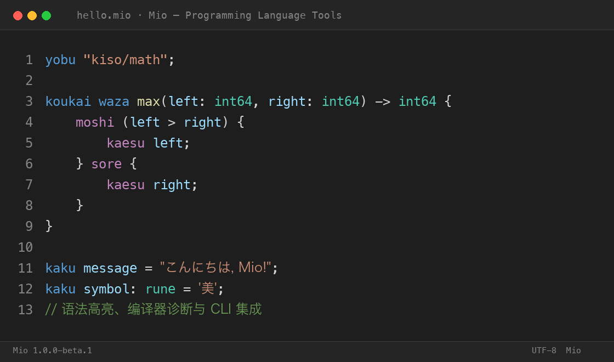
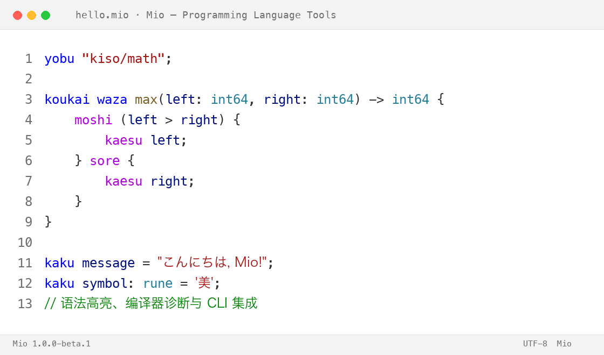

# Mio — Programming Language Tools

<p align="center">
  
</p>

<p align="center"><strong>Mio 编程语言的 Visual Studio Code 支持</strong></p>

<p align="center">
  <a href="https://github.com/ExMikuPro/Mio">Mio 项目</a> ·
  <a href="https://github.com/ExMikuPro/Mio/blob/main/docs/LANGUAGE.md">语言文档</a> ·
  <a href="https://github.com/ExMikuPro/Mio/releases">Releases</a>
</p>

Mio 是一门静态强类型编程语言，使用日语罗马音关键字，以 Mochi 字节码为执行目标，
并通过模块化的 **Bunko** 标准库按需导入能力。本插件为 VS Code 提供 `.mio` 文件的
语法高亮、编辑器约定、代码片段、MioCore 语言服务器诊断和 Mio CLI 命令。

即使没有安装 Mio CLI，插件也能提供完整的语法高亮与基础编辑体验。安装 CLI 后，插件
会自动从 `PATH` 查找 `mio` / `mio.exe`，也可以通过 `mio.executablePath` 指定路径。

## 语法高亮预览

深色主题：



浅色主题：



预览图由插件 TextMate 作用域配色生成，替换为真实编辑器截图的方法见
[docs/images/README.md](docs/images/README.md)。

## 功能

- **TextMate 语法高亮**，对应当前 Mio `1.0.0-beta.1` 使用的 V0.5 语言版本：
  - 关键字：`kaku`、`waza`、`moshi`、`sore`、`aida`、`kaesu`、`nukeru`、
    `tsuzuku`、`yobu`、`kata`、`sentaku`、`awase`、`baai`、`koukai`、`teisu`
  - `hai`、`iie`、`mu`
  - 内置类型：固定宽度整数、`float32`、`float64`、`rune`、`bool`、`string`、
    `unit`、`resource`、`Map`，以及 `Number`、`Integer`、`Signed`、`Float` 约束
  - 函数定义与调用、闭包、参数、结构体字段、枚举变体、`awase` 分支、泛型声明与
    应用、模块导入、数组、数字、字符串、rune、注释和运算符
  - 普通字符串和注释中的关键字不会被错误高亮
- **Language Configuration**：括号与引号自动闭合、自动包围、括号匹配、`//` 与
  `/* ... */` 注释、缩进规则、折叠标记、Mio 标识符 word pattern，以及基于括号和
  块注释的语法折叠。
- **代码片段**：变量、常量、函数、闭包、泛型、条件分支、`aida` 循环、
  `nukeru` / `tsuzuku`、返回、import、struct、enum、`awase`、数组、`Map`、
  可空值、rune 等。
- **Mio CLI 命令**：
  - `Mio: Check Current File`
  - `Mio: Run Current File`
  - `Mio: Build Current File`
  - `Mio: Show Compiler Version`
  - `Mio: Open Output`
- **MioCore 语言服务器**：通过 `vscode-languageclient` 启动 Mio CLI 的 `mio lsp`
  子命令。支持未保存缓冲区、文档版本校验、增量同步、请求取消，并把编译器
  UTF-8 字节偏移映射为 VS Code UTF-16 位置。
- **CLI 回退诊断**：语言服务器被禁用、不可用或停止时，回退到
  `mio check --format=json`。任一时刻只有一套诊断生效。
- **安全执行外部程序**：始终使用参数数组并关闭 shell；带空格、中文、日文的路径会
  原样传递，不拼接命令字符串。
- **中英文 README**，以及从项目语言标识派生的 128×128 Marketplace 图标。

## 安装

### 从 VSIX 安装（0.3.0）

```bash
code --install-extension mio-language-support-0.3.0.vsix
```

重新加载 VS Code 后打开任意 `.mio` 文件。

### 从源码构建

```bash
cd editors/vscode
npm ci
npm run compile
npx vsce package
code --install-extension mio-language-support-0.3.0.vsix
```

插件尚未发布到 Visual Studio Marketplace。`publisher` 字段是项目 GitHub 组织名
对应的占位值，发布前请阅读 [PUBLISHING.md](PUBLISHING.md)。

## 支持平台

- macOS（Apple Silicon 与 Intel）
- Windows（x64 与 ARM64）
- Linux（x64 与 ARM64）

插件本身与平台无关，但 Mio CLI 必须与当前平台匹配。

## Mio CLI 配置

在 Mio 仓库中构建 CLI：

```bash
go build -o mio ./cmd/mio
./mio version
```

将 `mio` 加入 `PATH`（Windows 为 `mio.exe`），或配置绝对路径。插件不会主动扫描工作区寻找 Mio 可执行文件，只使用配置路径或 `PATH`。

| 配置项 | 默认值 | 说明 |
| --- | --- | --- |
| `mio.executablePath` | `""` | Mio CLI 绝对路径。留空时从 `PATH` 查找 `mio` / `mio.exe`，支持 `~` 展开。 |
| `mio.languageServer.enabled` | `true` | 使用 `mio lsp` 启动 MioCore 语言服务器；关闭或不可用时回退到 `mio check`。 |
| `mio.diagnostics.enabled` | `true` | 显示诊断。语言服务器运行时由其提供，否则使用 `mio check --format=json`。 |
| `mio.diagnostics.onSave` | `true` | 仅回退模式：保存 `.mio` 文件后自动运行 `mio check`（350 ms 防抖）。 |
| `mio.outputDirectory` | `""` | `mio build` 的输出目录。留空时写入源文件旁的 `.mochi` 文件，支持 `${workspaceFolder}`。 |

插件**不提供** `mio.languageVersion`：当前 Mio CLI 没有语言版本参数。语法高亮和
代码片段以当前工具链使用的 V0.5 关键字集为准，版本差异见下表。

### Bunko 标准库

当文件使用 `yobu "kiso/..."` 时，`mio check` 与 `mio run` 需要 Bunko 根目录。
插件复用 CLI 的查找规则：

1. 环境变量 `MIO_BUNKO` 指向的目录；
2. 从源文件向上找到的最近 `bunko/` 目录。

如果 Bunko 位于项目之外，请在启动 VS Code 的环境中设置 `MIO_BUNKO`。

## 命令

| 命令 ID | 命令面板标题 | 需要 Mio CLI |
| --- | --- | --- |
| `mio.checkCurrentFile` | Mio: Check Current File | 是 |
| `mio.runCurrentFile` | Mio: Run Current File | 是 |
| `mio.buildCurrentFile` | Mio: Build Current File | 是 |
| `mio.showCompilerVersion` | Mio: Show Compiler Version | 是 |
| `mio.openOutput` | Mio: Open Output | 否 |

运行和构建命令会先保存未保存的 `.mio` 缓冲区。手动 `Check Current File` 会像
JetBrains 插件一样，将当前目录的 `.mio` 文件复制到临时包并只替换当前文件内容，
因此不必先保存即可检查最新文本。

找不到 CLI 时，插件会显示带有 **Open Settings** 和 **Installation Guide** 操作按钮的
引导信息；语法高亮和代码片段不受影响。

## Mio 语言版本

关键字分层来自 `internal/token/token.go`；当前 CLI 加载器使用 `token.V05`
（`internal/bunko/program.go`）。

| 版本 | 新增关键字 / 语法 |
| --- | --- |
| V0.1 | `kaku`、`waza`、`moshi`、`sore`、`kaesu`、`hai`、`iie`、`mu` |
| V0.2 | `aida`、`nukeru`、`tsuzuku` |
| V0.3 | `yobu` |
| V0.4 | `kata`、`sentaku`、`awase`、`baai` |
| V0.5 | `koukai`、`teisu` |

插件面向 V0.5。由于没有真实的 CLI 版本切换参数，插件不会为每个文件伪造版本开关。

## 当前支持范围

- 语法高亮、Language Configuration、代码片段、折叠、MioCore 语言服务器，以及上述
  五个 CLI 命令。
- 诊断来自 `mio lsp`。语言服务器复用 Lexer、Parser、Resolver、TypeChecker，通过
  内存 overlay 分析未保存缓冲区，支持增量编辑、文档版本校验和 `$/cancelRequest`。
- 编译器流水线在第一个错误处停止，因此每次分析最多发布一条诊断；包/导入错误可能不带
  源码位置。无法确认范围时，插件会把诊断显示在文件开头并明确说明，而不是猜测行号。
- 语言服务器不可用时自动回退到 `mio check --format=json`，并清空另一套诊断，
  Problems 面板不会同时出现两份来源。
- Hover、跳转定义、查找引用、文档符号、自动补全与签名提示已基于真实 AST、
  Resolver 绑定和类型结果实现；重命名、语义 Token 与格式化仍未实现，也不会被
  advertise。设计见 [docs/LSP_PLAN.md](docs/LSP_PLAN.md)。
- 不包含调试器、测试浏览器、格式化器或 Marketplace 发布。

## 已知限制

- 语言服务器与 CLI 回退都在第一个编译错误处停止，Problems 面板每次最多显示一条
  Mio 诊断。
- 语义结果要求当前文档及其导入能够解析。缓冲区不完整时只索引已成功解析的语句，
  语言服务器不会为损坏片段猜测符号。
- 跨模块引用覆盖当前程序图以及工作区中其它已打开的文档；既未打开也未被导入的文件
  会在打开后再参与索引。
- 自动补全暂不提供 `baai` 匹配分支变体，也不在类型标注中提供类型参数名。
- 没有源码位置的导入/包错误会显示在当前文件开头，并在消息中包含 CLI 报告的文件路径。
- Windows 上不执行 `.cmd` / `.bat` 启动器；请配置原生 `mio.exe`，以保持无 shell 执行。
- `mio.outputDirectory` 只影响 `mio build`；`mio run` 始终运行源文件。
- Marketplace Publisher ID 尚未最终确定，见 [PUBLISHING.md](PUBLISHING.md)。

## 开发与测试

```bash
npm ci
npm run compile
npm run lint
npm test
npx vsce package
npm run check:vsix
```

`npm test` 先运行 Node 单元测试（manifest、语法作用域、诊断映射、CLI 解析、进程
执行器），再通过 `@vscode/test-electron` 启动 Extension Host，验证激活、语言识别、
命令注册、代码片段、折叠、真实诊断、缺失 CLI，以及带空格/中文/日文的路径。

`pretest` 会在 Go 可用时构建 `cmd/mio` 到 `editors/vscode/.test-tmp/`。如果没有 Go，
依赖真实 CLI 的集成测试会明确跳过；插件本身不依赖 Go。

## 许可与素材

插件代码采用 MIT License，见 [LICENSE](LICENSE)。图标由 JetBrains Marketplace
图标（`editors/jetbrains/src/main/resources/META-INF/pluginIcon.svg`）内嵌的 PNG
等比例转换为 128×128 RGBA，未重新设计，也不是文件类型图标 `icons/mio.svg`。
`assets/mascot/` 下的其他 Mio / Mochi 角色插画**未**打包进本插件，因为其授权与
MIT 代码许可分开管理，详见 [NOTICE.md](NOTICE.md)。

## 相关链接

- [Mio 仓库](https://github.com/ExMikuPro/Mio)
- [Mio 语言文档](https://github.com/ExMikuPro/Mio/blob/main/docs/LANGUAGE.md)
- [Bunko 标准库](https://github.com/ExMikuPro/Mio/blob/main/docs/BUNKO.md)
- [JetBrains Mio — Programming Language Tools](https://github.com/ExMikuPro/Mio/tree/main/editors/jetbrains)
- [Issue Tracker](https://github.com/ExMikuPro/Mio/issues)
